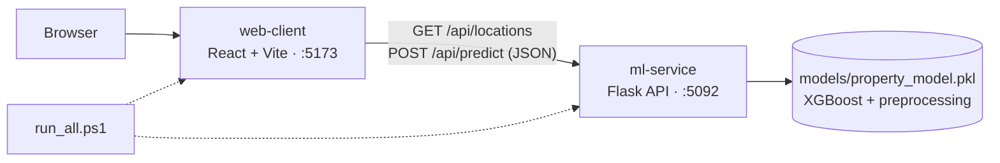
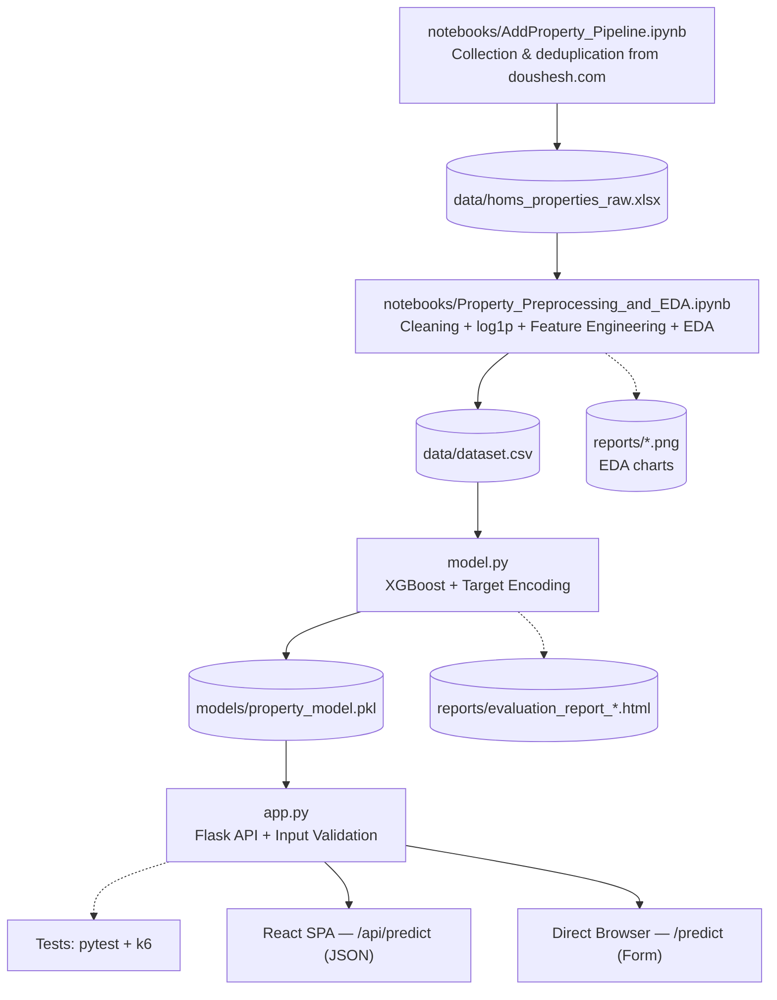

📖 Read in Arabic: [اللغة العربية](README_AR.md)

# 🏠 homs-real-estate-valuation-ml

**Homs Real Estate Price Predictor — part of the Sun Shadow platform**

**AI-assisted, guided price estimation for residential apartments in Homs, Syria — a Flask + XGBoost microservice with a React web client, runnable with a single command.**

The project has two independent parts that talk to each other only through a REST API:

| Part | Folder | What it is | Default address |
| --- | --- | --- | --- |
| **ML service** (backend) | `ml-service/` | Flask REST API serving an **XGBoost** model that estimates apartment prices from 16 input fields | `http://localhost:5092` |
| **Web client** (frontend) | `web-client/` | React + Vite + Tailwind CSS single-page app with a glassmorphism UI, Arabic/English (RTL/LTR) | `http://localhost:5173` |

> **Fixed ports:** the ML service always runs on **5092** and the React client on **5173**. Every default in this repository (CORS allow-list, `VITE_API_BASE_URL`, scripts, load test) assumes these two ports.

The ML service is the analytical module (AI-as-a-Service) of the **Sun Shadow** real estate platform (buy, sell, rent). It is fully decoupled from the main application (Laravel): no model logic is embedded in any other application.

> ⚠️ **Methodological note:** This service does not replace a specialized, on-site real estate appraisal. It provides a supporting quantitative price reference that helps the user form an initial expectation of an apartment's price.

---

## 📑 Table of Contents

- [Key Features](#-key-features)
- [Architecture](#-architecture)
- [Tech Stack](#-tech-stack)
- [Project Structure](#-project-structure)
- [Quick Start](#-quick-start)
- [Configuration](#-configuration)
- [Data & Model Pipeline](#-data--model-pipeline)
- [API Reference](#-api-reference)
- [Input Validation](#-input-validation)
- [Web Client](#-web-client)
- [Performance & Results](#-performance--results)
- [Troubleshooting](#-troubleshooting)
- [Notes & Scope of Use](#-notes--scope-of-use)

---

## ✨ Key Features

**ML service**

- **Training / serving separation.** Model building (`model.py → train()`) is separate in time and structure from live serving (`app.py`). Training produces a persisted bundle (`models/property_model.pkl`) that the server loads at startup, so the model can be retrained without touching the API logic.
- **16 inputs → 18 model features.** The API takes 16 input fields; preprocessing turns them into the 18 features the model consumes, including four derived ones:
  - `area_per_room` — total area ÷ number of rooms.
  - `net_to_total_ratio` — net area ÷ total area.
  - `has_heating` — binary indicator derived from `heating_type`.
  - `location_target_enc` — smoothed target encoding of the neighborhood.
- **Log1p price transformation.** The price target is trained on a `log1p` scale to reduce skew caused by a few high-value apartments, and converted back to USD with `expm1` at inference.
- **Smoothed target encoding for locations.** Per-neighborhood mean log-price is blended with the global mean using `smoothing_k = 8`, so a neighborhood seen once or twice is not trusted like a well-represented one. A location unseen at inference falls back to the global mean.
- **Hyperparameter tuning with repeated cross-validation.** `RandomizedSearchCV` (20 trials) with `RepeatedKFold` (5 folds × 5 repeats = 25 evaluation operations), then a final refit holding out 15% of the training data for validation with `Early Stopping` (40 rounds without improvement).
- **Strict server-side validation** of numeric bounds, categorical values, and area consistency — before any data reaches the model (see [Input Validation](#-input-validation)).
- **Configurable CORS** through the `ALLOWED_ORIGINS` environment variable.
- **Independent load testing** with Grafana k6, isolated from the training pipeline.

**Web client**

- Glassmorphism UI (backdrop blur over a hero image) built with Tailwind CSS v4.
- Arabic and English with automatic **RTL/LTR** switching through `i18next`; Arabic is the default.
- Client-side validation that mirrors the server's bounds, with per-field error messages.
- Districts are loaded from the service (`GET /api/locations`), so the dropdown always matches what the model knows.

**One-click tooling**

- `run_all.ps1` starts both servers and opens the app; `stop_all.ps1` shuts everything down.

---

## 🧭 Architecture



Both parts can also be consumed independently: the Flask service additionally ships a server-rendered test page (`POST /predict`, Jinja2) that needs no frontend build.

| Mode | Endpoint | Purpose |
| --- | --- | --- |
| **React SPA (decoupled)** | `POST /api/predict` | The production-facing interface and the primary consumer of the API |
| **Flask SSR (embedded)** | `POST /predict` | Quick in-browser testing without running the React app |

Both modes share the same validation, feature-engineering, and inference pipeline; only transport and rendering differ.

---

## 🛠️ Tech Stack

### ML service

| Category | Technology | Version |
| --- | --- | --- |
| Language | Python | **≥ 3.10** |
| Service framework | Flask | 3.0.3 |
| WSGI server | Werkzeug | 3.0.3 |
| CORS | Flask-CORS | — |
| ML model | XGBoost (`XGBRegressor`) | 2.1.1 |
| ML & evaluation | Scikit-Learn | 1.5.2 |
| Data processing | Pandas / NumPy | 2.2.2 / 1.26.4 |
| Random-search distributions | SciPy | 1.13.1 |
| Model bundle persistence | Joblib | 1.4.2 |
| Load testing | Grafana k6 | — |

> `model.py` uses PEP 604 union types (`dict | None`), so **Python 3.10 or later** is required.

### Web client

| Category | Technology | Version (`package.json`) |
| --- | --- | --- |
| UI library | React | ^19.2.8 |
| Build tool / dev server | Vite (+ `@vitejs/plugin-react`) | ^8.3.0 |
| Styling | Tailwind CSS (+ `@tailwindcss/vite`) | ^4.3.3 |
| HTTP client | Axios | ^1.20.0 |
| Internationalization | i18next, react-i18next, i18next-browser-languagedetector | ^26.4.2 / ^17.0.15 / ^8.2.1 |
| Notifications | react-hot-toast | ^2.6.1 |
| Linting | ESLint | ^10.10.0 |

### Tooling

PowerShell (`run_all.ps1`, `stop_all.ps1`), Visual Studio Code, Grafana k6, `pytest`.

---

## 📁 Project Structure

```
homs-real-estate-valuation-ml/
│
├── run_all.ps1                       # Starts Flask + React and opens the browser
├── stop_all.ps1                      # Stops the servers started by run_all.ps1
├── README.md
├── README_AR.md
│
├── ml-service/                       # Flask + XGBoost microservice
│   ├── data/
│   │   ├── homs_properties_raw.xlsx  # Raw collected dataset (123 rows × 33 columns)
│   │   └── dataset.csv               # Model-ready dataset (100 rows × 31 columns; output of the EDA notebook)
│   ├── notebooks/
│   │   ├── AddProperty_Pipeline.ipynb              # Listing ingestion + duplicate detection
│   │   └── Property_Preprocessing_and_EDA.ipynb    # Cleaning, feature engineering, EDA, dataset export
│   ├── models/
│   │   └── property_model.pkl        # Persisted bundle (model + encoders + target-encoding map + medians)
│   ├── reports/                      # evaluation_report_*.html and EDA charts (*.png)
│   ├── static/hero.jpg               # Hero image of the embedded Flask page
│   ├── templates/index.html          # Embedded server-rendered UI (Jinja2), served via /predict
│   ├── tests/
│   │   ├── flask_test.js             # k6 load scenario (targets /api/predict)
│   │   ├── flask_summary.html        # Report generated by the k6 run
│   │   └── test_app.py               # pytest unit tests for the Flask server
│   ├── app.py                        # Flask server and REST endpoints
│   ├── model.py                      # Cleaning, feature engineering, training, inference
│   └── requirements.txt              # Pinned dependencies
│
└── web-client/                       # React + Vite + Tailwind CSS client
    ├── index.html
    ├── package.json
    ├── vite.config.js                # react() + tailwindcss() plugins
    ├── .env                          # VITE_API_BASE_URL
    └── src/
        ├── main.jsx, App.jsx, index.css
        ├── i18n.js                   # i18next setup + <html dir/lang> sync
        ├── i18n/locales/             # ar.json, en.json
        ├── assets/hero.jpg           # Background image of the estimator page
        ├── pages/PricePredictor.jsx  # The estimator page
        ├── components/
        │   ├── LanguageToggle.jsx
        │   └── predictor/FormControls.jsx
        ├── constants/predictorOptions.js   # Form defaults, field rules, allowed categorical values
        ├── services/predictorApi.js        # All HTTP calls to the Flask service
        └── utils/validatePredictorForm.js  # Client-side validation
```

### Model bundle (`property_model.pkl`)

Persisted with Joblib; it holds everything needed to reproduce training-time preprocessing at inference:

| Component | Description |
| --- | --- |
| `model` | The trained `XGBRegressor` |
| `features` | Feature order used in training |
| `label_encoders` / `label_encoder_modes` | `LabelEncoder`s for categorical features plus fallbacks for unseen categories |
| `target_enc_map` / `global_log_mean` | Smoothed location encoding map and the global mean |
| `train_medians` | Training-set medians used to impute missing values |
| `binary_mappings` | Raw text values mapped to each binary feature (elevator, parking, furnished) |
| `metrics` | R², MAE, ±15% accuracy, cross-validation results |

`load_model()` looks for `models/model_bundle.joblib` first and falls back to `models/property_model.pkl` (the file `train()` produces).

---

## 🚀 Quick Start

### Prerequisites

- **Windows** with PowerShell (for the one-click scripts)
- **Python 3.10+** with `pip` and `venv`
- **Node.js** (an LTS version supported by Vite 8) and `npm`
- (Optional) [Grafana k6](https://grafana.com/docs/k6/latest/) for load testing

### First-time setup (once)

```powershell
# 1) Clone
git clone https://github.com/DalaaAudi/homs-real-estate-valuation-ml.git
cd homs-real-estate-valuation-ml

# 2) ML service: environment and dependencies
cd ml-service
python -m venv venv
venv\Scripts\activate
pip install -r requirements.txt

# 3) Train the model (skip if models/property_model.pkl already exists)
python model.py
cd ..

# 4) Web client: dependencies
cd web-client
npm install
cd ..
```

Training writes `models/property_model.pkl`, an HTML evaluation report to `reports/`, and prints R², MAE, and ±15% accuracy to the terminal. Run `model.py` and `app.py` from `ml-service/`.

### Run everything with one click

From the project root:

```powershell
.\run_all.ps1
```

If PowerShell blocks the script because of the execution policy, run it for this session only:

```powershell
powershell -ExecutionPolicy Bypass -File .\run_all.ps1
```

`run_all.ps1` starts the **Flask server** (`ml-service/`, port 5092) and the **React dev server** (`web-client/`, port 5173) together, then opens your browser automatically at **http://localhost:5173**.

Both scripts live in the **project root** and build every path from their own location using `$PSScriptRoot`. There are no hard-coded absolute paths, so the project folder can be cloned or moved anywhere on your machine.

| Service | URL |
| --- | --- |
| Web client (React) | http://localhost:5173 |
| ML service (Flask) | http://localhost:5092 |
| Service status | http://localhost:5092/api/status |
| Embedded test page | http://localhost:5092/ |

### Stop everything

```powershell
.\stop_all.ps1
```

Like `run_all.ps1`, it runs from the project root. It shuts down all Python and Node servers and the PowerShell windows. Because it stops them all, save any other Python/Node work before running it.

### Run manually (any OS)

Start each server from **its own folder**: enter `ml-service` for the backend and `web-client` for the frontend. Running `app.py` or `npm run dev` from the project root will fail, because the relative paths (`data/`, `models/`, `package.json`) belong to those folders. Use two terminals.

```bash
# Terminal 1 — ML service
cd ml-service
source venv/bin/activate        # Windows: venv\Scripts\activate
python app.py                   # serves on http://localhost:5092

# Terminal 2 — Web client
cd web-client
npm run dev                     # serves on http://localhost:5173
```

### Optional: load test

With the Flask server running on port `5092`:

```bash
cd ml-service
k6 run tests/flask_test.js
```

This prints a text summary and generates `flask_summary.html`.

---

## ⚙️ Configuration

### ML service (environment variables)

| Variable | Description | Default |
| --- | --- | --- |
| `ALLOWED_ORIGINS` | Comma-separated CORS-allowed origins for `/api/*` | `http://localhost:5173,http://127.0.0.1:5173,http://localhost:3000,http://localhost:8080` |
| `FLASK_SECRET_KEY` | Secret key for Flask sessions (used by `flash`) | Random key generated if unset |

The service listens on port **5092**.

### Web client (`web-client/.env`)

| Variable | Description | Default |
| --- | --- | --- |
| `VITE_API_BASE_URL` | Base URL of the Flask service | `http://localhost:5092` |

```
VITE_API_BASE_URL=http://localhost:5092
```

Vite reads `.env` only at startup: restart `npm run dev` after changing it. The file must be named exactly `.env`, sit next to `package.json`, and use the `VITE_` prefix.

---

## 🔄 Data & Model Pipeline



1. **Collection** — `AddProperty_Pipeline.ipynb` collects and deduplicates listings from [doushesh.com](https://doushesh.com/flats-for-sale/homs-1) into `data/homs_properties_raw.xlsx`.
2. **Preprocessing & EDA** — `Property_Preprocessing_and_EDA.ipynb` cleans the data, applies `log1p`, engineers the derived features, exports `data/dataset.csv`, and saves the EDA charts to `reports/`.
3. **Modeling** — `model.py` reads `data/dataset.csv`, trains `XGBRegressor` with smoothed location encoding, and saves the bundle plus a timestamped HTML report.
4. **Serving & testing** — `app.py` loads the bundle and exposes the REST API; `pytest` and k6 cover it independently.
5. **Consumption** — through the React client (`POST /api/predict`) or the embedded page (`POST /predict`).

> **Working directory matters.** The notebooks use paths relative to `ml-service/notebooks/` (`../data/`, `../reports/`); `model.py` and `app.py` use paths relative to `ml-service/` (`data/`, `models/`, `reports/`). Open the notebooks from their own folder and run the scripts from `ml-service/`.

---

## 🔌 API Reference

Base URL: `http://localhost:5092`

### `POST /api/predict`

Accepts apartment specifications as JSON and returns the guided estimate. This is the endpoint the React client uses.

**Headers:** `Content-Type: application/json`

**Request body:**

```json
{
  "location": "الحمراء",
  "total_area": 120,
  "net_area": 100,
  "rooms_count": 3,
  "bathrooms_count": 2,
  "halls_count": 1,
  "floor_num": 2,
  "building_age": 5,
  "heating_type": "تدفئة ديزل",
  "house_condition": "مسكون من صاحبه",
  "legal_status": "طابو أخضر/نظامي",
  "near_hospital": 1,
  "near_market": 1,
  "has_elevator": 1,
  "has_parking": 0,
  "is_furnished": 0
}
```

**Response — `200 OK`:**

```json
{
  "success": true,
  "predicted_price_usd": 87500,
  "price_per_sqm_usd": 729,
  "location": "الحمراء",
  "total_area_m2": 120
}
```

**Errors:**

| Status | Meaning | Cause |
| --- | --- | --- |
| `400` | Bad Request | Invalid JSON, a value outside the allowed bounds, an unrecognized category, or inconsistent areas. The reason is returned in the `error` field. |
| `503` | Service Unavailable | The model is not loaded (not trained yet, or the bundle could not be loaded) |
| `500` | Internal Server Error | Unexpected error during inference |

### `GET /api/status`

Reports whether the model is loaded, with its core metrics.

```json
{
  "status": "ready",
  "model_name": "XGBoost (RandomSearch + RepeatedKFold)",
  "locations_count": 42,
  "r2_score": 0.7174,
  "accuracy_15pct": 28.0
}
```

When the model is not ready, the service answers `503` with `{ "status": "not_ready", "error": "No model found." }`.

### `GET /api/locations`

Returns the neighborhoods known to the model, sorted alphabetically.

```json
{
  "success": true,
  "locations": ["الحمراء", "الوعر", "كرم الشامي", "..."]
}
```

### `POST /predict`

Serves the embedded server-rendered page (`templates/index.html`). It takes form data (`multipart/form-data` or `x-www-form-urlencoded`) and returns an HTML page with the result. Intended for direct in-browser testing.

---

## ✅ Input Validation

Validation happens twice: in the browser for immediate feedback, and on the server as the authority.

### Server-side rules (`/api/predict`)

| Field | Type | Bounds / allowed values | Required |
| --- | --- | --- | --- |
| `location` | string | Any location; an unknown one falls back to the global mean | ✅ |
| `total_area` | number | 20 – 1000 m² | ✅ |
| `net_area` | number | 15 – 1000 m² | Optional (defaults to 90% of total area) |
| `rooms_count` | integer | 1 – 10 | Optional (default 3) |
| `bathrooms_count` | integer | 1 – 5 | Optional (default 1) |
| `halls_count` | integer | 0 – 5 | Optional (default 1) |
| `floor_num` | integer | -3 – 15 | Optional (default 0) |
| `building_age` | number | 0 – 100 years | Optional (default 5) |
| `heating_type` | string | `لا يوجد`, `تدفئة ديزل`, `مدفئة ديزل`, `تدفئة مركزية` | Optional |
| `house_condition` | string | `مسكون من صاحبه`, `فارغ`, `مؤجر` | Optional |
| `legal_status` | string | `طابو أخضر/نظامي`, `كاتب عدل/وكالة`, `حكم محكمة` | Optional |
| `near_hospital`, `near_market`, `has_elevator`, `has_parking`, `is_furnished` | binary | 0/1 (the React client sends `true`/`false`) | Optional (default 0) |

> **Consistency rule:** `net_area` must not exceed `total_area × 1.05` (net area may be at most 5% larger than total area). Violations return `400 Bad Request`.

Categorical values are matched **character for character**, so they must be sent exactly as listed above.

### Client-side rules (web client)

The estimator form applies the same numeric bounds and the same 5% area rule, but it is stricter about completeness: **all 16 fields are required** (the three dropdowns must not stay on the blank option, and the district must be selected). Invalid fields are highlighted with an inline message, and no request is sent until the form is valid. Any message the server returns in `error` is shown in a toast.

---

## 🖥️ Web Client

- **Estimator page** (`pages/PricePredictor.jsx`) — four glass cards: *Location & Area*, *Building Details*, *Legal & Status*, *Amenities*; the result card shows the estimated price, price per m², district, and area.
- **Language** — Arabic by default, English on demand through the language toggle. The choice is stored in `localStorage`, and `<html dir>` / `lang` follow it automatically (RTL for Arabic, LTR for English).
- **Service layer** — all HTTP calls live in `services/predictorApi.js`; form defaults, field rules, and allowed categorical values live in `constants/predictorOptions.js`, so a change to the server's allowed values is a one-file edit.
- **Server status** — if `GET /api/locations` fails, the page shows a "server not ready" banner and disables the submit button.

---

## 📊 Performance & Results

### Model performance

| Metric | Value |
| --- | --- |
| R² (test set) | **0.7174 (71.74%)** |
| Repeated cross-validation R² | **0.7246 ± 0.1324** |
| Mean Absolute Error (MAE) | **15,459 USD** |
| Predictions within ±15% | **28.0%** |

> R² shows the model explains a meaningful share of price variance on the test data, and MAE gives the average error in USD. The small gap between cross-validation R² and test R² is not, on its own, enough evidence of strong generalization; read the numbers together with the nature of the local data.

### Load test (Grafana k6)

A ramping-VUs scenario targeted `/api/predict` directly:

| Metric | Value |
| --- | --- |
| Total HTTP requests | **288** |
| Failed request rate | **0.00%** |
| 95th percentile response time (P95) | **98.40 ms** |

These results describe the service under the specific test configuration used; they are not a guarantee of performance under arbitrary production load.

---

## 🩺 Troubleshooting

| Symptom | Likely cause and fix |
| --- | --- |
| Red banner "Server or Model not ready" | Flask is not running on port `5092`, or the model file is missing. Open `http://localhost:5092/api/status`; if it returns `503`, run `python model.py` in `ml-service/`. |
| Browser console shows a CORS error | The frontend origin is missing from `ALLOWED_ORIGINS`. Use `http://localhost:5173` (or add your origin to the variable). |
| `Network Error` / connection refused | Wrong port or address in `web-client/.env`. Make sure `VITE_API_BASE_URL` matches the Flask port, then restart `npm run dev`. |
| `400` after pressing calculate | A value is outside the bounds, or a categorical value does not match the server's list exactly. The toast shows the server's `error` message. |
| Styles missing (plain HTML look) | `tailwindcss()` is missing from the plugins in `web-client/vite.config.js`, or the dev server was not restarted after editing it. |
| `run_all.ps1` is blocked | Run it with `powershell -ExecutionPolicy Bypass -File .\run_all.ps1`. |
| `SyntaxError` on `dict \| None` | Python older than 3.10. Upgrade the interpreter. |

---

## 📌 Notes & Scope of Use

- The model is built on real residential listings collected from a local real estate platform in Homs; it is not an official dataset published by that platform.
- It currently covers **residential apartments in the city of Homs only** — not villas, commercial units, offices, or land.
- The goal is a **guided price reference**, not a substitute for a specialized on-site appraisal when making actual buy/sell decisions.
- All preprocessing components (encoders, location encoding map, medians) are stored inside the model bundle, so preprocessing is identical in training and live inference.

---

## 🔗 Part of the Larger System

This project is one component of **Sun Shadow**, a full-stack real estate platform for buying, selling, and renting properties, developed as a graduation project at the Faculty of Informatics Engineering, Homs University (Department of Software Engineering and Information Systems).

- **Main web platform:** Laravel + MySQL
- **Price estimation service and client (this repository):** Flask + XGBoost, React
