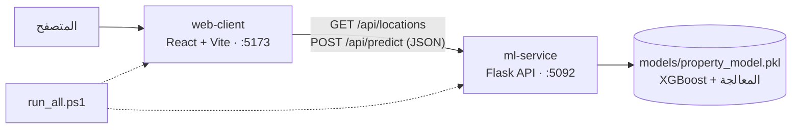
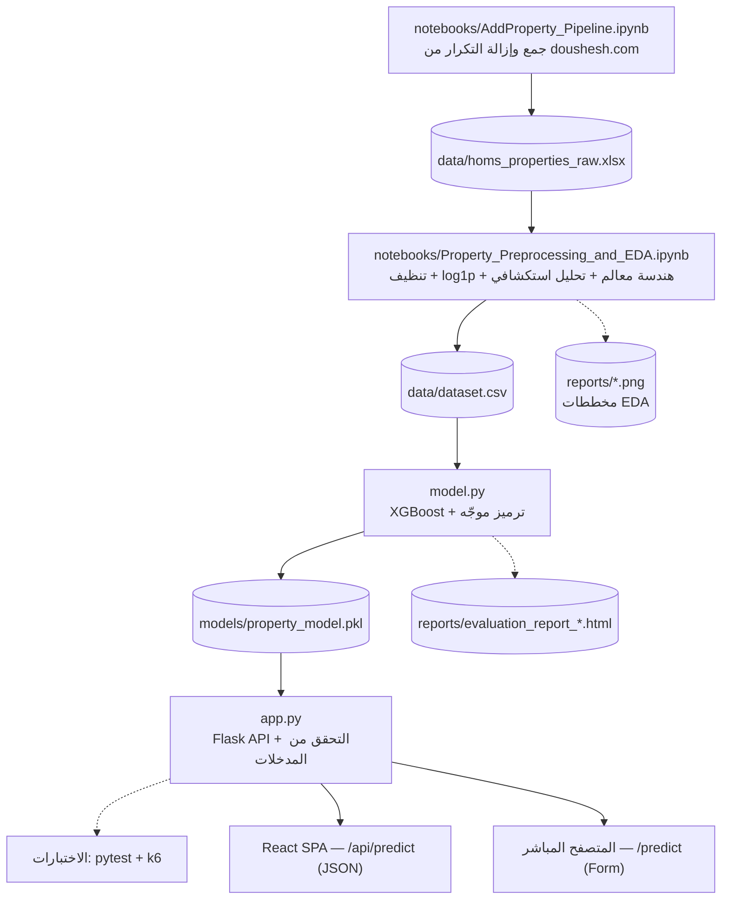

📖 Read in English: [English Version](README.md)

# 🏠 homs-real-estate-valuation-ml

**مُقيّم أسعار العقارات في حمص (Homs Real Estate Price Predictor) — جزء من منصة Sun Shadow**

**تقدير سعري استرشادي مدعوم بالذكاء الاصطناعي للشقق السكنية في مدينة حمص، سوريا — خدمة مصغّرة (Flask + XGBoost) مع واجهة ويب (React) تعمل بأمر واحد.**

يتألف المشروع من جزأين مستقلين لا يتواصلان إلا عبر واجهة برمجية REST:

| الجزء | المجلد | الوصف | العنوان الافتراضي |
| --- | --- | --- | --- |
| **خدمة التعلّم الآلي** (الباك أند) | `ml-service/` | واجهة Flask REST تخدم نموذج **XGBoost** يقدّر أسعار الشقق اعتماداً على 16 حقل إدخال | `http://localhost:5092` |
| **واجهة الويب** (الفرونت إند) | `web-client/` | تطبيق صفحة واحدة بـ React + Vite + Tailwind CSS بتصميم زجاجي (Glassmorphism)، عربي/إنجليزي (RTL/LTR) | `http://localhost:5173` |

> **المنافذ ثابتة:** تعمل خدمة التعلّم الآلي دائماً على المنفذ **5092** وواجهة React على المنفذ **5173**. جميع الإعدادات الافتراضية في هذا المستودع (قائمة CORS المسموحة، و`VITE_API_BASE_URL`، والسكربتات، واختبار الحمل) تفترض هذين المنفذين.

تُشكّل خدمة التعلّم الآلي الموديول التحليلي (AI-as-a-Service) ضمن منصة **Sun Shadow** لبيع وشراء وتأجير العقارات، وتعمل بمعزل تام عن التطبيق الرئيسي (Laravel)، دون تضمين منطق النموذج داخل أي تطبيق آخر.

> ⚠️ **ملاحظة منهجية:** هذه الخدمة لا تُغني عن التقييم العقاري الميداني المتخصص، بل توفّر مرجعية سعرية كمية مساندة تساعد المستخدم على تكوين تصور أولي عن سعر الشقة.

---

## 📑 جدول المحتويات

- [المميزات الرئيسية](#-المميزات-الرئيسية)
- [البنية المعمارية](#-البنية-المعمارية)
- [التقنيات المستخدمة](#-التقنيات-المستخدمة)
- [هيكلية المشروع](#-هيكلية-المشروع)
- [البدء السريع](#-البدء-السريع)
- [الإعدادات](#-الإعدادات)
- [خط البيانات والنمذجة](#-خط-البيانات-والنمذجة)
- [مرجع واجهات البرمجة](#-مرجع-واجهات-البرمجة)
- [التحقق من المدخلات](#-التحقق-من-المدخلات)
- [واجهة الويب](#-واجهة-الويب)
- [الأداء والنتائج](#-الأداء-والنتائج)
- [استكشاف الأخطاء وإصلاحها](#-استكشاف-الأخطاء-وإصلاحها)
- [ملاحظات ونطاق الاستخدام](#-ملاحظات-ونطاق-الاستخدام)

---

## ✨ المميزات الرئيسية

**خدمة التعلّم الآلي**

- **فصل التدريب عن التشغيل.** مرحلة بناء النموذج (`model.py → train()`) منفصلة زمنياً وبنيوياً عن الخدمة الحية (`app.py`). ينتج عن التدريب حزمة محفوظة (`models/property_model.pkl`) يحمّلها الخادم عند الإقلاع، فيمكن إعادة تدريب النموذج دون المساس بمنطق الـ API.
- **16 مُدخلاً ← 18 معلماً للنموذج.** تستقبل الواجهة البرمجية 16 حقلاً، وتحوّلها المعالجة إلى 18 معلماً يستهلكها النموذج، منها أربعة معالم مشتقة:
  - `area_per_room` — المساحة الإجمالية ÷ عدد الغرف.
  - `net_to_total_ratio` — المساحة الصافية ÷ المساحة الإجمالية.
  - `has_heating` — مؤشر ثنائي مشتق من `heating_type`.
  - `location_target_enc` — الترميز الموجه الممهّد للحي.
- **التحويل اللوغاريتمي للسعر (Log1p).** يُدرَّب النموذج على مقياس `log1p` للحد من التواء التوزيع الناتج عن عدد محدود من الشقق مرتفعة الثمن، ثم يُعاد السعر إلى الدولار بـ `expm1` عند التنبؤ.
- **ترميز مستهدف ممهّد للمواقع.** يُمزج متوسط لوغاريتم السعر لكل حي مع المتوسط العام بمعامل تنعيم `smoothing_k = 8`، فلا يُعامَل حي ظهر مرة أو مرتين كحي موثوق إحصائياً. وأي موقع غير معروف عند التنبؤ يُستبدل بالمتوسط العام.
- **ضبط المعلمات الفائقة بتقييم تقاطعي متكرر.** `RandomizedSearchCV` (20 تجربة) مع `RepeatedKFold` (5 طيات × 5 تكرارات = 25 عملية تقييم)، ثم إعادة تدريب نهائية تحجز 15% من بيانات التدريب للتحقق مع `Early Stopping` (40 دورة دون تحسن).
- **تحقق صارم على الخادم** من الحدود العددية والقيم الفئوية واتساق المساحات، قبل وصول أي بيانات إلى النموذج (انظر [التحقق من المدخلات](#-التحقق-من-المدخلات)).
- **CORS قابل للتهيئة** عبر متغير البيئة `ALLOWED_ORIGINS`.
- **اختبار حمل مستقل** باستخدام Grafana k6 بمعزل عن مسار التدريب.

**واجهة الويب**

- تصميم زجاجي (Backdrop Blur فوق صورة رئيسية) مبني بـ Tailwind CSS v4.
- العربية والإنجليزية مع تبديل تلقائي لاتجاه الصفحة **RTL/LTR** عبر `i18next`، والعربية هي الافتراضية.
- تحقق من المدخلات في المتصفح يطابق حدود الخادم، مع رسالة خطأ لكل حقل.
- تُجلب الأحياء من الخدمة (`GET /api/locations`) فتطابق القائمة دائماً ما يعرفه النموذج.

**أدوات التشغيل بضغطة زر**

- `run_all.ps1` يشغّل الخادمين ويفتح التطبيق، و`stop_all.ps1` يغلق كل شيء.

---

## 🧭 البنية المعمارية



يمكن أيضاً استهلاك كل جزء بصورة مستقلة: تتضمن خدمة Flask صفحة اختبار مُولَّدة من جانب الخادم (`POST /predict`، Jinja2) لا تحتاج إلى بناء واجهة.

| النمط | نقطة النهاية | الغرض |
| --- | --- | --- |
| **React SPA (منفصلة)** | `POST /api/predict` | الواجهة الإنتاجية والمستهلك الرئيسي للـ API |
| **Flask SSR (مدمجة)** | `POST /predict` | اختبار سريع من المتصفح دون تشغيل تطبيق React |

يتشارك النمطان منطق التحقق وهندسة المعالم وخط الاستدلال نفسه؛ والفرق في طبقة النقل والعرض فقط.

---

## 🛠️ التقنيات المستخدمة

### خدمة التعلّم الآلي

| الفئة | التقنية | الإصدار |
| --- | --- | --- |
| لغة البرمجة | Python | **≥ 3.10** |
| إطار عمل الخدمة | Flask | 3.0.3 |
| خادم WSGI | Werkzeug | 3.0.3 |
| سياسة المصادر (CORS) | Flask-CORS | — |
| نموذج التعلّم الآلي | XGBoost (`XGBRegressor`) | 2.1.1 |
| التعلّم الآلي والتقييم | Scikit-Learn | 1.5.2 |
| معالجة البيانات | Pandas / NumPy | 2.2.2 / 1.26.4 |
| توزيعات البحث العشوائي | SciPy | 1.13.1 |
| حفظ حزمة النموذج | Joblib | 1.4.2 |
| اختبار الحمل | Grafana k6 | — |

> يستخدم `model.py` صياغة أنواع الاتحاد PEP 604 (`dict | None`)، لذلك تُشترط **بايثون 3.10 أو أحدث**.

### واجهة الويب

| الفئة | التقنية | الإصدار (`package.json`) |
| --- | --- | --- |
| مكتبة الواجهة | React | ^19.2.8 |
| أداة البناء / خادم التطوير | Vite (+ `@vitejs/plugin-react`) | ^8.3.0 |
| التنسيق | Tailwind CSS (+ `@tailwindcss/vite`) | ^4.3.3 |
| عميل HTTP | Axios | ^1.20.0 |
| تعدد اللغات | i18next وreact-i18next وi18next-browser-languagedetector | ^26.4.2 / ^17.0.15 / ^8.2.1 |
| الإشعارات | react-hot-toast | ^2.6.1 |
| فحص الكود | ESLint | ^10.10.0 |

### الأدوات

PowerShell (`run_all.ps1`، `stop_all.ps1`)، Visual Studio Code، Grafana k6، `pytest`.

---

## 📁 هيكلية المشروع

```
homs-real-estate-valuation-ml/
│
├── run_all.ps1                       # يشغّل Flask وReact ويفتح المتصفح
├── stop_all.ps1                      # يوقف الخوادم التي شغّلها run_all.ps1
├── README.md
├── README_AR.md
│
├── ml-service/                       # الخدمة المصغّرة Flask + XGBoost
│   ├── data/
│   │   ├── homs_properties_raw.xlsx  # البيانات الخام المجمّعة (123 صفاً × 33 عموداً)
│   │   └── dataset.csv               # البيانات الجاهزة للنموذج (100 صف × 31 عموداً؛ مخرج دفتر EDA)
│   ├── notebooks/
│   │   ├── AddProperty_Pipeline.ipynb              # إدخال الإعلانات + كشف التكرار
│   │   └── Property_Preprocessing_and_EDA.ipynb    # التنظيف، هندسة المعالم، التحليل الاستكشافي، تصدير البيانات
│   ├── models/
│   │   └── property_model.pkl        # الحزمة المحفوظة (النموذج + المشفّرات + خريطة الترميز + الوسطاء)
│   ├── reports/                      # evaluation_report_*.html ومخططات EDA (*.png)
│   ├── static/hero.jpg               # الصورة الرئيسية لصفحة Flask المدمجة
│   ├── templates/index.html          # الواجهة المدمجة (Jinja2)، تُعرض عبر /predict
│   ├── tests/
│   │   ├── flask_test.js             # سيناريو حمل k6 (يستهدف /api/predict)
│   │   ├── flask_summary.html        # التقرير المولّد من تشغيل k6
│   │   └── test_app.py               # اختبارات وحدة pytest لخادم Flask
│   ├── app.py                        # خادم Flask ونقاط REST
│   ├── model.py                      # التنظيف وهندسة المعالم والتدريب والاستدلال
│   └── requirements.txt              # الاعتماديات المثبّتة
│
└── web-client/                       # واجهة React + Vite + Tailwind CSS
    ├── index.html
    ├── package.json
    ├── vite.config.js                # إضافتا react() وtailwindcss()
    ├── .env                          # VITE_API_BASE_URL
    └── src/
        ├── main.jsx, App.jsx, index.css
        ├── i18n.js                   # إعداد i18next ومزامنة <html dir/lang>
        ├── i18n/locales/             # ar.json، en.json
        ├── assets/hero.jpg           # صورة خلفية صفحة المقيّم
        ├── pages/PricePredictor.jsx  # صفحة المقيّم
        ├── components/
        │   ├── LanguageToggle.jsx
        │   └── predictor/FormControls.jsx
        ├── constants/predictorOptions.js   # قيم النموذج الافتراضية وقواعد الحقول والقيم الفئوية المسموحة
        ├── services/predictorApi.js        # كل طلبات HTTP إلى خدمة Flask
        └── utils/validatePredictorForm.js  # التحقق من المدخلات في المتصفح
```

### حزمة النموذج (`property_model.pkl`)

تُحفظ بـ Joblib، وتحتوي على كل ما يلزم لإعادة إنتاج معالجة التدريب أثناء الاستدلال:

| المكوّن | الوصف |
| --- | --- |
| `model` | نموذج `XGBRegressor` المدرَّب |
| `features` | ترتيب المعالم المعتمد في التدريب |
| `label_encoders` / `label_encoder_modes` | مشفّرات `LabelEncoder` للمعالم الفئوية وقيم احتياطية للفئات غير المعروفة |
| `target_enc_map` / `global_log_mean` | خريطة الترميز الممهّد للمواقع والمتوسط العام |
| `train_medians` | وسطاء بيانات التدريب لتعويض القيم المفقودة |
| `binary_mappings` | القيم النصية المقابلة للمعالم الثنائية (مصعد، موقف، تأثيث) |
| `metrics` | R² وMAE والدقة ضمن ±15% ونتائج التقييم التقاطعي |

تبحث `load_model()` أولاً عن `models/model_bundle.joblib`، ثم تتراجع إلى `models/property_model.pkl` (الملف الذي تنتجه `train()`).

---

## 🚀 البدء السريع

### المتطلبات

- **Windows** مع PowerShell (لسكربتات التشغيل بضغطة زر)
- **Python 3.10+** مع `pip` و`venv`
- **Node.js** (إصدار LTS يدعمه Vite 8) و`npm`
- (اختياري) [Grafana k6](https://grafana.com/docs/k6/latest/) لاختبار الحمل

### الإعداد الأول (مرة واحدة)

```powershell
# 1) استنساخ المستودع
git clone https://github.com/DalaaAudi/homs-real-estate-valuation-ml.git
cd homs-real-estate-valuation-ml

# 2) خدمة التعلّم الآلي: البيئة والاعتماديات
cd ml-service
python -m venv venv
venv\Scripts\activate
pip install -r requirements.txt

# 3) تدريب النموذج (تجاوزيه إن كان models/property_model.pkl موجوداً)
python model.py
cd ..

# 4) واجهة الويب: الاعتماديات
cd web-client
npm install
cd ..
```

ينتج التدريب الملف `models/property_model.pkl` وتقرير تقييم HTML في `reports/`، ويطبع R² وMAE والدقة ضمن ±15% في الطرفية. شغّل `model.py` و`app.py` من داخل `ml-service/`.

### تشغيل كل شيء بضغطة زر

من جذر المشروع:

```powershell
.\run_all.ps1
```

إن منع PowerShell تشغيل السكربت بسبب سياسة التنفيذ (Execution Policy)، شغّله لهذه الجلسة فقط:

```powershell
powershell -ExecutionPolicy Bypass -File .\run_all.ps1
```

يشغّل `run_all.ps1` **خادم Flask** (`ml-service/`، المنفذ 5092) و**خادم React** (`web-client/`، المنفذ 5173) معاً، ثم يفتح المتصفح تلقائياً على **http://localhost:5173**.

يوجد السكربتان في **الجذر الرئيسي للمشروع**، ويبنيان كل المسارات انطلاقاً من موقعهما باستخدام `$PSScriptRoot`. لا توجد مسارات مطلقة مكتوبة يدوياً، لذلك يمكن استنساخ مجلد المشروع أو نقله إلى أي مكان على جهازك.

| الخدمة | العنوان |
| --- | --- |
| واجهة الويب (React) | http://localhost:5173 |
| خدمة التعلّم الآلي (Flask) | http://localhost:5092 |
| حالة الخدمة | http://localhost:5092/api/status |
| صفحة الاختبار المدمجة | http://localhost:5092/ |

### إيقاف كل شيء

```powershell
.\stop_all.ps1
```

يُشغَّل هو أيضاً من الجذر الرئيسي كما `run_all.ps1`، ويغلق جميع خوادم بايثون ونود ونوافذ PowerShell. ولأنه يغلقها جميعاً، احفظ أي عمل آخر بالبايثون أو النود قبل تشغيله.

### التشغيل اليدوي (أي نظام تشغيل)

شغّل كل خادم من **مجلده الخاص**: ادخل إلى `ml-service` لخدمة الباك أند، وإلى `web-client` للفرونت إند. تشغيل `app.py` أو `npm run dev` من جذر المشروع سيفشل، لأن المسارات النسبية (`data/` و`models/` و`package.json`) تخص هذين المجلدين. استخدم طرفيتين.

```bash
# الطرفية 1 — خدمة التعلّم الآلي
cd ml-service
source venv/bin/activate        # على Windows: venv\Scripts\activate
python app.py                   # تعمل على http://localhost:5092

# الطرفية 2 — واجهة الويب
cd web-client
npm run dev                     # تعمل على http://localhost:5173
```

### اختياري: اختبار الحمل

مع تشغيل خادم Flask على المنفذ `5092`:

```bash
cd ml-service
k6 run tests/flask_test.js
```

يطبع ملخصاً نصياً ويولّد تقرير `flask_summary.html`.

---

## ⚙️ الإعدادات

### خدمة التعلّم الآلي (متغيرات البيئة)

| المتغيّر | الوصف | القيمة الافتراضية |
| --- | --- | --- |
| `ALLOWED_ORIGINS` | نطاقات CORS المسموحة لـ `/api/*`، مفصولة بفواصل | `http://localhost:5173,http://127.0.0.1:5173,http://localhost:3000,http://localhost:8080` |
| `FLASK_SECRET_KEY` | مفتاح سرّي لجلسات Flask (يُستخدم لآلية `flash`) | مفتاح عشوائي يُولَّد تلقائياً إن لم يُحدَّد |

تستمع الخدمة على المنفذ **5092**.

### واجهة الويب (`web-client/.env`)

| المتغيّر | الوصف | القيمة الافتراضية |
| --- | --- | --- |
| `VITE_API_BASE_URL` | العنوان الأساسي لخدمة Flask | `http://localhost:5092` |

```
VITE_API_BASE_URL=http://localhost:5092
```

يقرأ Vite الملف `.env` عند الإقلاع فقط: أعد تشغيل `npm run dev` بعد أي تعديل عليه. يجب أن يكون اسم الملف `.env` تماماً، وبجانب `package.json`، وأن يبدأ اسم المتغير بالبادئة `VITE_`.

---

## 🔄 خط البيانات والنمذجة



1. **جمع البيانات** — يجمع `AddProperty_Pipeline.ipynb` الإعلانات من [doushesh.com](https://doushesh.com/flats-for-sale/homs-1) ويزيل تكرارها إلى `data/homs_properties_raw.xlsx`.
2. **المعالجة والتحليل الاستكشافي** — ينظّف `Property_Preprocessing_and_EDA.ipynb` البيانات، ويطبّق `log1p`، ويهندس المعالم المشتقة، ويصدّر `data/dataset.csv`، ويحفظ مخططات EDA في `reports/`.
3. **النمذجة** — يقرأ `model.py` الملف `data/dataset.csv`، ويدرّب `XGBRegressor` مع الترميز الممهّد للمواقع، ويحفظ الحزمة وتقريراً مؤرَّخاً بصيغة HTML.
4. **التشغيل والاختبار** — يحمّل `app.py` الحزمة ويعرضها كواجهة REST؛ وتغطيها `pytest` وk6 بصورة مستقلة.
5. **الاستهلاك** — عبر واجهة React (`POST /api/predict`) أو الصفحة المدمجة (`POST /predict`).

> **مجلد العمل مهم.** تستخدم الدفاتر مسارات نسبية إلى `ml-service/notebooks/` (`../data/`، `../reports/`)، بينما يستخدم `model.py` و`app.py` مسارات نسبية إلى `ml-service/` (`data/`، `models/`، `reports/`). افتح الدفاتر من مجلدها، وشغّل السكربتات من `ml-service/`.

---

## 🔌 مرجع واجهات البرمجة

العنوان الأساسي: `http://localhost:5092`

### `POST /api/predict`

تستقبل مواصفات الشقة بصيغة JSON وتعيد التقدير الاسترشادي. وهي النقطة التي تستخدمها واجهة React.

**Headers:** `Content-Type: application/json`

**جسم الطلب:**

```json
{
  "location": "الحمراء",
  "total_area": 120,
  "net_area": 100,
  "rooms_count": 3,
  "bathrooms_count": 2,
  "halls_count": 1,
  "floor_num": 2,
  "building_age": 5,
  "heating_type": "تدفئة ديزل",
  "house_condition": "مسكون من صاحبه",
  "legal_status": "طابو أخضر/نظامي",
  "near_hospital": 1,
  "near_market": 1,
  "has_elevator": 1,
  "has_parking": 0,
  "is_furnished": 0
}
```

**الاستجابة — `200 OK`:**

```json
{
  "success": true,
  "predicted_price_usd": 87500,
  "price_per_sqm_usd": 729,
  "location": "الحمراء",
  "total_area_m2": 120
}
```

**الأخطاء:**

| الكود | الحالة | السبب |
| --- | --- | --- |
| `400` | Bad Request | JSON غير صالح، أو قيمة خارج الحدود، أو فئة غير معروفة، أو مساحات غير متسقة. يُعاد السبب في الحقل `error`. |
| `503` | Service Unavailable | النموذج غير محمَّل (لم يُدرَّب بعد أو تعذّر تحميل الحزمة) |
| `500` | Internal Server Error | خطأ داخلي غير متوقع أثناء الاستدلال |

### `GET /api/status`

يبيّن إن كان النموذج محمَّلاً مع مقاييسه الأساسية.

```json
{
  "status": "ready",
  "model_name": "XGBoost (RandomSearch + RepeatedKFold)",
  "locations_count": 42,
  "r2_score": 0.7174,
  "accuracy_15pct": 28.0
}
```

إن لم يكن النموذج جاهزاً تردّ الخدمة بـ `503` مع `{ "status": "not_ready", "error": "No model found." }`.

### `GET /api/locations`

يعيد الأحياء المعروفة لدى النموذج، مرتّبة أبجدياً.

```json
{
  "success": true,
  "locations": ["الحمراء", "الوعر", "كرم الشامي", "..."]
}
```

### `POST /predict`

يخدم الصفحة المدمجة المُولَّدة من جانب الخادم (`templates/index.html`). يستقبل بيانات نموذج (`multipart/form-data` أو `x-www-form-urlencoded`) ويعيد صفحة HTML فيها النتيجة. مخصص للاختبار المباشر من المتصفح.

---

## ✅ التحقق من المدخلات

يجري التحقق مرتين: في المتصفح لتغذية راجعة فورية، وعلى الخادم بوصفه المرجع النهائي.

### قواعد الخادم (`/api/predict`)

| الحقل | النوع | الحدود / القيم المسموحة | إلزامي |
| --- | --- | --- | --- |
| `location` | نص | أي موقع؛ غير المعروف يُعامَل بالمتوسط العام | ✅ |
| `total_area` | رقم | 20 – 1000 م² | ✅ |
| `net_area` | رقم | 15 – 1000 م² | اختياري (افتراضياً 90% من المساحة الإجمالية) |
| `rooms_count` | عدد صحيح | 1 – 10 | اختياري (افتراضي 3) |
| `bathrooms_count` | عدد صحيح | 1 – 5 | اختياري (افتراضي 1) |
| `halls_count` | عدد صحيح | 0 – 5 | اختياري (افتراضي 1) |
| `floor_num` | عدد صحيح | -3 – 15 | اختياري (افتراضي 0) |
| `building_age` | رقم | 0 – 100 سنة | اختياري (افتراضي 5) |
| `heating_type` | نص | `لا يوجد`، `تدفئة ديزل`، `مدفئة ديزل`، `تدفئة مركزية` | اختياري |
| `house_condition` | نص | `مسكون من صاحبه`، `فارغ`، `مؤجر` | اختياري |
| `legal_status` | نص | `طابو أخضر/نظامي`، `كاتب عدل/وكالة`، `حكم محكمة` | اختياري |
| `near_hospital`، `near_market`، `has_elevator`، `has_parking`، `is_furnished` | ثنائي | 0/1 (تُرسلها واجهة React بصيغة `true`/`false`) | اختياري (افتراضي 0) |

> **قاعدة الاتساق:** يجب ألّا تتجاوز `net_area` القيمة `total_area × 1.05` (أي ألا تزيد المساحة الصافية على الإجمالية بأكثر من 5%). المخالفة تُعيد `400 Bad Request`.

تُطابَق القيم الفئوية **حرفاً بحرف**، لذلك يجب إرسالها كما هي مكتوبة أعلاه تماماً.

### قواعد الواجهة (متصفح المستخدم)

يطبّق نموذج المقيّم الحدود العددية نفسها وقاعدة الـ 5% للمساحات، لكنه أشد في اكتمال البيانات: **جميع الحقول الـ 16 إلزامية** (يجب ألا تبقى القوائم الثلاث على الخيار الفارغ، ويجب اختيار الحي). تُظلَّل الحقول غير الصالحة برسالة تحتها، ولا يُرسَل أي طلب قبل أن يصبح النموذج صالحاً. وأي رسالة يعيدها الخادم في الحقل `error` تظهر في إشعار منبثق.

---

## 🖥️ واجهة الويب

- **صفحة المقيّم** (`pages/PricePredictor.jsx`) — أربع بطاقات زجاجية: *الموقع والمساحة*، *تفاصيل البناء*، *الحالة والوضع القانوني*، *المميزات*؛ وتعرض بطاقة النتيجة السعر التقديري وسعر المتر المربع والحي والمساحة.
- **اللغة** — العربية افتراضياً، والإنجليزية عند الطلب عبر زر تبديل اللغة. يُحفظ الاختيار في `localStorage`، ويتبعه `<html dir>` و`lang` تلقائياً (RTL للعربية وLTR للإنجليزية).
- **طبقة الخدمة** — جميع طلبات HTTP في `services/predictorApi.js`؛ وقيم النموذج الافتراضية وقواعد الحقول والقيم الفئوية المسموحة في `constants/predictorOptions.js`، فتعديل قيم الخادم المسموحة يتطلب تغيير ملف واحد.
- **حالة الخادم** — إن فشل `GET /api/locations` تعرض الصفحة شريط تنبيه «السيرفر غير متصل أو النموذج غير محمّل» وتعطّل زر الإرسال.

---

## 📊 الأداء والنتائج

### أداء النموذج

| المقياس | القيمة |
| --- | --- |
| معامل التحديد R² (مجموعة الاختبار) | **0.7174 (71.74%)** |
| R² بالتقييم التقاطعي المتكرر | **0.7246 ± 0.1324** |
| متوسط الخطأ المطلق (MAE) | **15,459 USD** |
| نسبة التنبؤات ضمن ±15% | **28.0%** |

> يشير R² إلى أن النموذج يفسّر جزءاً مهماً من تباين الأسعار في بيانات الاختبار، ويعبّر MAE عن متوسط الخطأ بالدولار. والفرق المحدود بين R² في التقييم التقاطعي وقيمته على الاختبار لا يكفي وحده دليلاً على جودة التعميم؛ تُقرأ الأرقام مع طبيعة البيانات المحلية.

### اختبار الحمل (Grafana k6)

سيناريو تدريجي (Ramping VUs) استهدف `/api/predict` مباشرة:

| المقياس | القيمة |
| --- | --- |
| إجمالي طلبات HTTP | **288** |
| نسبة الطلبات الفاشلة | **0.00%** |
| زمن الاستجابة عند المئين 95 (P95) | **98.40 ms** |

تصف هذه النتائج سلوك الخدمة ضمن إعدادات الاختبار المستخدمة، ولا تُعدّ ضماناً للأداء تحت أي حمل إنتاجي محتمل.

---

## 🩺 استكشاف الأخطاء وإصلاحها

| العَرَض | السبب المحتمل والحل |
| --- | --- |
| شريط أحمر «السيرفر غير متصل أو النموذج غير محمّل» | Flask لا يعمل على المنفذ `5092`، أو ملف النموذج غير موجود. افتح `http://localhost:5092/api/status`؛ إن أعاد `503` شغّل `python model.py` داخل `ml-service/`. |
| خطأ CORS في Console المتصفح | نطاق الواجهة غير مدرج في `ALLOWED_ORIGINS`. استخدم `http://localhost:5173` (أو أضف نطاقك إلى المتغير). |
| `Network Error` / رفض الاتصال | منفذ أو عنوان خاطئ في `web-client/.env`. تأكد أن `VITE_API_BASE_URL` يطابق منفذ Flask ثم أعد تشغيل `npm run dev`. |
| `400` بعد الضغط على احسب | قيمة خارج الحدود، أو قيمة فئوية لا تطابق قائمة الخادم حرفياً. يعرض الإشعار رسالة `error` من الخادم. |
| غياب التنسيق (شكل HTML خام) | إضافة `tailwindcss()` غير مدرجة في `web-client/vite.config.js`، أو لم يُعد تشغيل الخادم بعد تعديله. |
| منع تشغيل `run_all.ps1` | شغّله بالأمر `powershell -ExecutionPolicy Bypass -File .\run_all.ps1`. |
| `SyntaxError` عند `dict \| None` | إصدار بايثون أقدم من 3.10. حدّث المفسّر. |

---

## 📌 ملاحظات ونطاق الاستخدام

- بُني النموذج على إعلانات سكنية حقيقية جُمعت من منصة عقارية محلية في حمص، وليست مجموعة بيانات رسمية منشورة من تلك المنصة.
- يغطي النموذج حالياً **الشقق السكنية في مدينة حمص فقط**، دون الفلل أو المحلات التجارية أو المكاتب أو الأراضي.
- الهدف تقديم **مرجعية سعرية استرشادية**، لا الاستعاضة عن التقييم العقاري الميداني المتخصص عند اتخاذ قرارات فعلية بالشراء أو البيع.
- تُحفظ جميع مكونات المعالجة (المشفّرات، خريطة ترميز الموقع، الوسطاء) داخل حزمة النموذج، لضمان تطابق المعالجة بين التدريب والاستدلال الحي.

---

## 🔗 جزء من منظومة أكبر

هذا المشروع أحد مكوّنات **Sun Shadow**، وهي منصة إلكترونية متكاملة لبيع وشراء وتأجير العقارات، طُوّرت ضمن مشروع تخرج في كلية الهندسة المعلوماتية بجامعة حمص (قسم هندسة البرمجيات ونظم المعلومات).

- **منصة الويب الأساسية:** Laravel + MySQL
- **خدمة التقدير السعري وواجهتها (هذا المستودع):** Flask + XGBoost، React
